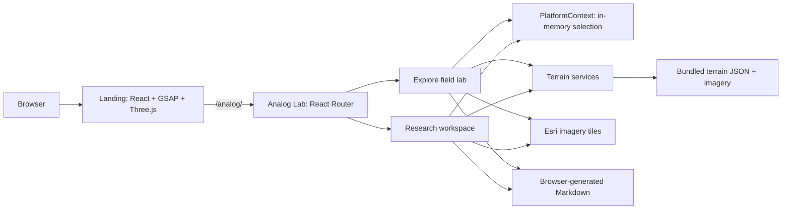

# Redshift / AstraTerra

AstraTerra is a frontend-only planetary analog experience. The landing page presents a rotating Earth with Moon and Mars reveals and a scroll story. The Analog Lab provides Explore and Research workspaces for comparing Earth sites with planetary terrain and documenting a provisional recommendation.

## What runs where

| URL | Source | Purpose |
| --- | --- | --- |
| `/` | `frontend_two copy/src/` | Animated landing and scroll experience |
| `/analog/` | `analog/analog/src/` | Analog Lab overview |
| `/analog/explore` | `analog/analog/src/pages/ExplorePage.tsx` | Guided field investigation |
| `/analog/research` | `analog/analog/src/components/Research/` | Spatial and evidence analysis |

The root `src/` is an earlier standalone prototype. `ColorEarth/` and the root model files are source/reference assets. The deployable site is built from **`frontend_two copy` and `analog/analog`**. The downloaded `solarjourney/` and `turionspace/` reference captures and the `analog.zip` archive are excluded from Git and deployment.

## Run locally

Requires a recent Node.js version supported by Vite 8 and npm. From the repository root:

```bash
npm ci --prefix analog/analog
npm ci --prefix "frontend_two copy"
npm run site:dev
```

Open `http://localhost:5173/` for the landing page or `http://localhost:5173/analog/` for the lab. Vite listens on all interfaces for VS Code port forwarding. The forwarded URL's **root path** opens the landing page; add `/analog/` to open the lab. If you change the lab source while the landing dev server is running, restart `site:dev` to rebuild the packaged lab.

For a production build:

```bash
npm run site:build
```

The output is `frontend_two copy/dist/`. The build script compiles the lab with base path `/analog/`, copies it to the landing app's `public/analog/`, synchronizes terrain data to `public/data/`, then builds the landing app. Those copied files and `dist/` are generated; edit the source folders instead.

## Host on Render

The included `render.yaml` defines a static site. Connect this GitHub repository to [Render](https://render.com/docs/static-sites), choose **Blueprint**, and let Render use `render.yaml`. It installs both frontend packages, runs the combined build, and publishes `frontend_two copy/dist`. The route rule rewrites direct visits to `/analog/explore` and `/analog/research` to the lab's SPA entry point. No web service, database, environment variables, or backend process is required.

If setting up a static site manually, use:

```text
Build command: npm ci --prefix analog/analog && npm ci --prefix "frontend_two copy" && node scripts/build-site.mjs
Publish directory: frontend_two copy/dist
Rewrite: /analog/* -> /analog/index.html
Redirect: /analog -> /analog/
```

The site uses root-relative asset paths such as `/images/` and `/data/`, so host it at the domain root. A project subpath such as GitHub Pages' `/redshift/` needs a separate base-path conversion. Render's [static-site rewrites](https://render.com/docs/redirects-rewrites) preserve the lab's client-side routes.

## Architecture



- **Landing:** `frontend_two copy/src/App.tsx` coordinates the hero, scroll chapters, and loader. `EarthGlobe.tsx` loads the bundled Earth model; `Planet.tsx` controls the timed Moon/Mars hover reveal through `HalftoneReveal.jsx`. GSAP ScrollTrigger and Lenis drive the scroll story.
- **Lab routing:** `analog/analog/src/App.tsx` mounts the pages under the Vite base path. `PlatformContext.tsx` shares the current target, site, objective, and Explore decision during a browser session.
- **Explore:** `ExplorePage.tsx` advances through brief, planetary target, Earth candidates, comparison, and decision. The map components inspect bundled terrain; sites without local grids are labelled accordingly.
- **Research:** `ResearchWorkspace.tsx` combines a Leaflet spatial view, local terrain visualization, evidence/feasibility panels, comparison, and report generation.
- **Terrain services:** `terrainDataService.ts` fetches and validates bundled JSON grids. `geospatialService.ts` computes terrain derivatives and draws map layers on canvas. Source and evidence registries label provenance and limitations.

## Data flow and limits

1. A visitor selects a mission, planetary region, and Earth site. The selection lives in React state in `PlatformContext`; refreshing the page resets it.
2. The browser fetches local files from `/data/terrains/` (Yungay Copernicus GLO-30 and Gale Crater USGS-derived 30 m analysis grids). `terrainDataService` validates grid dimensions and caches loaded datasets in memory.
3. The browser computes slope, roughness, and other display layers from those grids. The Earth candidate map also requests Esri World Imagery tiles directly from Esri; that map requires network access.
4. Explore stores the written recommendation in context for the Research handoff. Reports are assembled in the browser and downloaded locally as Markdown. There is no server-side storage, account, or API.

The bundled Moon reference has **no local quantitative DEM**; the UI marks that gap. Some Earth candidates have literature/location profiles without a bundled local elevation grid. A separate demonstration-data mode in Research is explicitly synthetic and should not be treated as measured terrain. The recommendation and readiness labels are provisional research aids, not scientific certification.

## Source data and assets

See `frontend_two copy/ASSETS.md` and `analog/analog/src/data/sourceRegistry.ts` for image and scientific source links. Large original model assets are kept in the source tree. The site is a research frontend and does not claim NASA endorsement.
