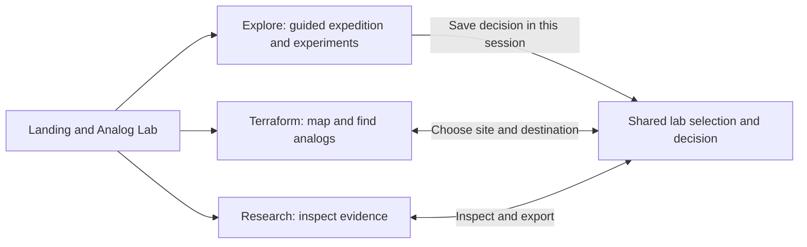
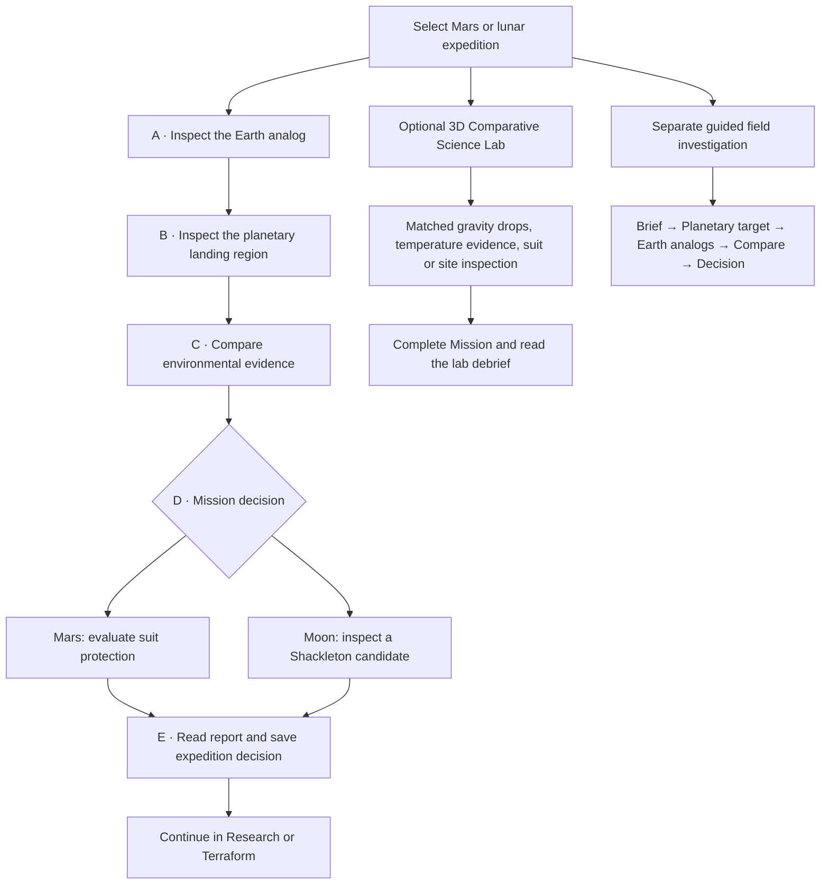
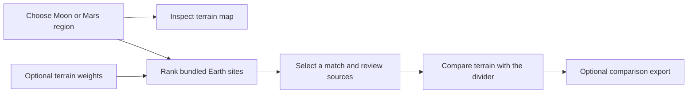
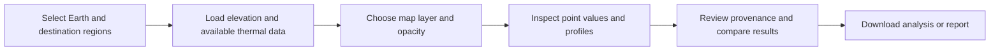
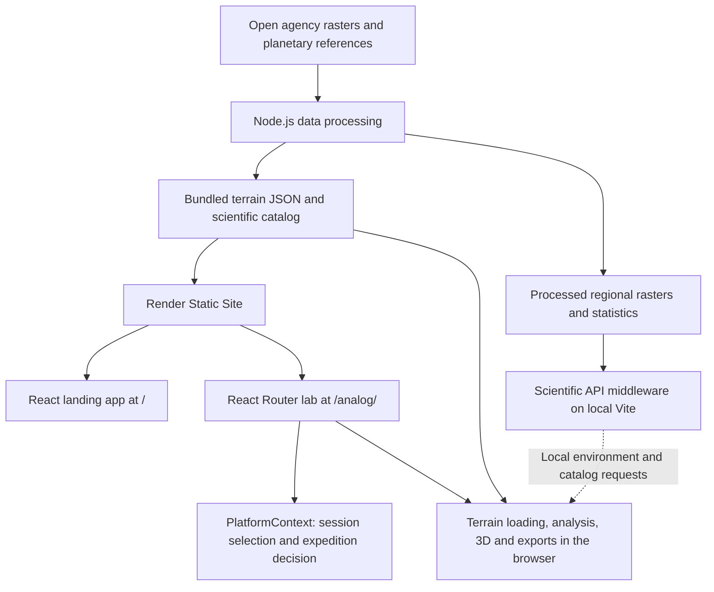
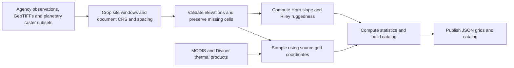
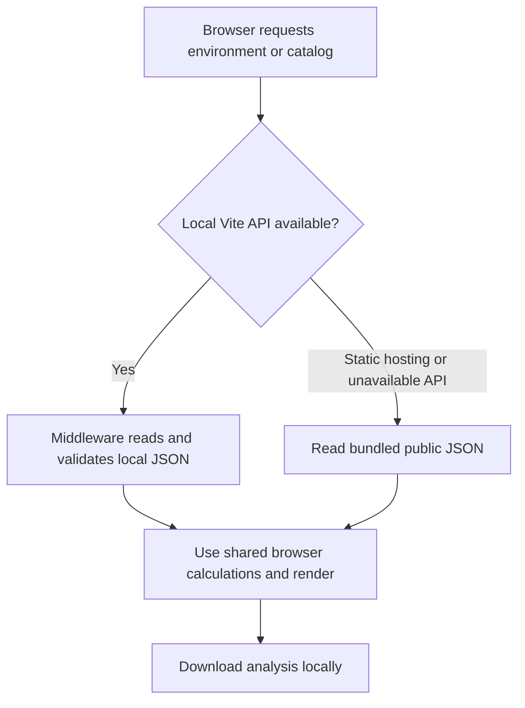
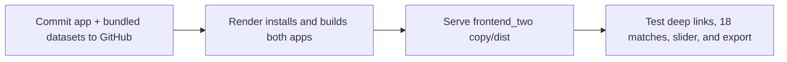

# AstraTerra · Earth analogs for the Moon and Mars

Team Red Shift built AstraTerra for the 2026 NASA Space Apps Challenge. It uses open planetary data to map destination terrain, identify Earth sites with useful similarities, and show which differences still matter for exploration. The current catalog compares **18 Earth terrain windows** with **six Moon and Mars regions**. Rankings describe terrain features at the scale of the bundled data.

## Start here

| Page | What you can do |
| --- | --- |
| `/` | Open the interactive landing page and enter the Analog Lab. |
| `/analog/` | Find the three workspaces and choose where to begin. |
| `/analog/explore` | Follow either guided A–E expedition, open the 3D lab, or complete the separate guided map investigation. |
| `/analog/explore/launch-mission?mission=mission-1-mars` | Run the Atacama to Mars 3D mission. Use `mission-2-moon` for McMurdo to Shackleton. |
| `/analog/learn` | Map a destination, rank Earth matches, check sources, and drag the terrain divider in Terraform. |
| `/analog/research` | Inspect terrain cells, compare map layers and statistics, and export an analysis. |



## How to use Explore

Open **Explore** and choose **The Red Planet Survival Challenge** (Atacama to Mars) or **The Lunar South Pole Expedition** (McMurdo to Shackleton). The stage controls are on the main Explore page.

| Stage | What to do | Why it matters |
| --- | --- | --- |
| **A · Earth baseline** | Inspect the Earth raster, change terrain layers, and open points of interest. | Establish what was observed or derived at the field site. |
| **B · Planetary landing** | Move to Mars or the lunar south pole and inspect the destination raster. Click a terrain location for its values. | Put Earth observations beside the destination’s terrain. |
| **C · Environment and survival** | Compare terrain, gravity, atmospheric conditions, and available temperature evidence. | Distinguish raster measurements, derived metrics, and published references. |
| **D · Decision** | Try the Mars suit simulation or inspect the available measurements at a Shackleton candidate. | Identify a useful action and the evidence still needed. |
| **E · Outcome and report** | Read the expedition outcome. Select **Save Expedition Decision to Platform**, then open Research or Terraform. | Carry the decision into the next workspace during the same app session. |



### 3D Comparative Science Lab

Select **Open 3D Comparative Science Lab** in the expedition header. Keep the same object and height on both worlds when running the gravity trial. A 12 m idealized drop takes about **1.56 seconds on Earth, 2.54 seconds on Mars, and 3.85 seconds on the Moon**. The simulation assumes a release from rest and ignores drag. Its timeline uses the same free-fall equation as the displayed result.

On Mars, test **WITHOUT EVA SUIT** and **WITH PRESSURIZED EVA SUIT**. The simulated suit assumes a seal, oxygen supply, and carbon dioxide removal. Log the temperature observation or the available evidence status on both sides. The Mars temperature is a published planetary reference. For the lunar mission, inspect a Shackleton candidate pin or terrain cell. Select **Complete Mission** when the checklist is complete. This opens the lab debrief.

### Guided map investigation

The lower Explore workflow is a separate investigation. Start with a **Brief**, choose a **Planetary target**, shortlist **Earth analogs**, **Compare** their terrain, and record a **Decision**. It emphasizes map evidence and a provisional field recommendation.

## How to use Terraform

1. Open **Terraform** and select **Moon** or **Mars**. Choose a region, such as **South Pole: Shackleton** or **Jezero: Western Delta**.
2. Switch between elevation, slope, and roughness. Click the map to inspect a cell.
3. Browse the automatic Earth rankings and select a match. Open **Terrain source** for the elevation product and **Field research source** where provided for the analog context.
4. Drag the divider or use the arrow keys to reveal either terrain. Each map shows its own footprint width. Compare broad patterns with those scale differences in mind.
5. Expand **Advanced maps, weights and export** to adjust the comparison, inspect additional map controls, or export an annotated comparison.



The overall ranking is a weighted average of three component scores. The height component uses relief and elevation variability. The slope and ruggedness components use the mean and 90th percentile. With the default settings, the supported weights are proportional to **20:25:25**. Temperature is excluded because the available records represent different observation conditions. The divider compares visual patterns and preserves the footprint labels. At the default weights, McMurdo ranks first for Shackleton in this catalog at **56.82/100**, with roughness its strongest component at **69.15/100**. That suggests a candidate for further investigation of rough-terrain route planning.

## How to use Research

1. Choose an Earth site and a planetary destination. Select elevation, slope, roughness, temperature where supported, or the similarity layer.
2. Click a cell to inspect its numerical values and units. Adjust heatmap opacity, compare profiles, and read the source and limitations.
3. Select **Save Analysis** to download JSON, or **Export Scientific Report** to open the report export.



Terraform compares regional statistics. Research also makes a cell-level similarity view using corresponding positions inside the selected windows. The compared positions belong to separate coordinate systems and the windows can cover different extents.

## Architecture and frontend integration



- **Landing app.** [frontend_two copy/src](frontend_two%20copy/src) renders the animated globe and scroll story. React drives the interface, Three.js renders the globe, and GSAP and Lenis handle motion and scrolling.
- **Analog Lab.** [analog/analog/src/App.tsx](analog/analog/src/App.tsx) routes Explore, Terraform, and Research. [PlatformContext](analog/analog/src/context/PlatformContext.tsx) shares destination, Earth site, and expedition selections during navigation. Reloading starts a new session.
- **Rendering.** Leaflet provides geographic maps. Canvas draws local raster overlays and the Terraform divider. Three.js and React Three Fiber render scientific experiments. React holds controls and results, and the [comparative simulation engine](analog/analog/src/services/comparativeSimulationEngine.ts) provides calculations.
- **Data access.** [Terrain data service](analog/analog/src/services/terrainDataService.ts) locates, validates, and caches bundled grids in browser memory. [Geospatial service](analog/analog/src/services/geospatialService.ts) builds layer data, samples cells, and renders maps. [Analog discovery](analog/analog/src/services/analogDiscoveryService.ts) loads the catalog and calls the [shared ranking module](analog/analog/src/services/analogRanking.mjs).
- **Build integration.** [build-site.mjs](scripts/build-site.mjs) builds the lab with a `/analog/` base, copies its output to the landing app’s `public/analog/`, copies bundled data to `public/data/`, then builds the landing site. The combined output is `frontend_two copy/dist/`. Root `src/` is an earlier standalone prototype.

## Backend and scientific data pipeline

### Offline processing



The [Node pipeline](analog/analog/scripts/build-scientific-pipeline.mjs) runs locally against bundled inputs by default. GeoTIFF.js reads source raster windows and Proj4js transforms coordinates. [terrainMetrics.mjs](analog/analog/src/services/terrainMetrics.mjs) computes Horn slope and Riley ruggedness from a complete 3×3 neighborhood. Edges and missing neighborhoods remain null. [thermalSampling.mjs](analog/analog/src/services/thermalSampling.mjs) maps terrain cell centers into MODIS or Diviner source grids. Masked observations remain unavailable.

| Location | Contents |
| --- | --- |
| `analog/analog/public/data/terrains/` | Public elevation windows, thermal products, and selected imagery. |
| `analog/analog/public/data/processed/scientific-catalog.json` | Catalog of site grids, statistics, provenance, and default rankings. |
| `data/raw/` and `datasets/raw-nasa-archives/` | Source metadata, PDS labels and selected excerpts used for provenance and processing. |
| `data/processed/` and `data/analytics/` | Batch outputs for local API and analysis. |
| `planetary_environment/` | Published environmental references and limitations. The pipeline copies these to the public bundle. |

### Local API and production data

[scientific-api-middleware.mjs](scripts/scientific-api-middleware.mjs) runs inside the local Vite lab server or the combined landing server. It reads files, caches parsed JSON by file size and modification time, validates inputs, and returns JSON. The default Render site serves static assets. The browser can read the bundled catalog and planetary references directly, performs its own ranking, and assembles exports locally. This version requires no database or dedicated API service.



| Local endpoint | Purpose |
| --- | --- |
| `GET /api/planetary-environment/:body` | Earth, Mars, or Moon reference values and context. |
| `GET /api/research/sites` and `/datasets` | List Earth candidates, planetary targets, and processed data metadata. |
| `GET /api/research/layers` and `/statistics` | Describe layers and report regional statistics. |
| `GET /api/research/layers/:layerId/tiles/0/0/0` | Return a supported complete region grid. |
| `GET /api/research/point-query?row=64&col=64` | Sample a terrain cell. Add `datasetId` to inspect a different window. |
| `POST /api/research/compare` and `/similarity` | Compare site statistics or calculate a weighted Earth ranking. |
| `POST /api/research/export` | Return a JSON response for an export request. The UI downloads results in the browser. |
| `GET /api/research/certification` | Report that validated base certification rasters are unavailable. |

Invalid coordinates or weights produce a request error. Missing datasets or unsupported layers return an explicit error. Valid locations can still have null values where a layer has no observation.

## Datasets and provenance

| Product | Main use | Important limit |
| --- | --- | --- |
| [NASADEM HGT V001](https://doi.org/10.5067/MEASURES/NASADEM/NASADEM_HGT.001) | Earth elevation | The source has latitude coverage limits. |
| [Copernicus DEM GLO-30](https://dataspace.copernicus.eu/explore-data/data-collections/copernicus-contributing-missions/collections-description/COP-DEM) | Earth terrain including polar/supplementary sites and 12 additional analogs | A surface model can include vegetation and structures. |
| [Terra MODIS MOD11A2](https://doi.org/10.5067/MODIS/MOD11A2.061) and [Aqua MYD11A2](https://doi.org/10.5067/MODIS/MYD11A2.061) | Earth land surface temperature | Day/night composites have specific observation periods and can contain masked cells. |
| [LRO LOLA](https://pds-geosciences.wustl.edu/missions/lro/) | Lunar elevation at Shackleton, Marius Hills, and Mare Tranquillitatis | Local map coverage and nominal spacing vary by grid. |
| [LRO Diviner](https://pds-geosciences.wustl.edu/missions/lro/diviner.htm) | Shackleton-region polar thermal data | Bundled observations represent a specific season and local-time interval. |
| [MGS MOLA MEGDR](https://pds-geosciences.wustl.edu/missions/mgs/megdr.html) | Regional Mars elevation, including Jezero | The Jezero window is coarse and intended for regional interpretation. |
| [USGS/NASA Gale merged DEM](https://astrogeology.usgs.gov/search/map/mars_msl_gale_merged_dem_1m) | Localized Gale terrain | Source resolution differs from bundled analysis spacing. |

Each bundled grid records the source product, provider, extent, coordinate system, and processing. See [SCIENTIFIC_AUDIT.md](SCIENTIFIC_AUDIT.md) for acquisition and limitations and [ASSETS.md](frontend_two%20copy/ASSETS.md) for media sources. External imagery tiles need network access. Landing or base decisions also require evidence on hazards, illumination, communications, resources, radiation, and engineering conditions.

## Run, test, and deploy

From the repository root, use Node.js 22.20.0 or a compatible Node version.

```powershell
npm ci --prefix analog/analog
npm ci --prefix "frontend_two copy"
npm run site:dev
```

Open `http://localhost:5173/analog/` or the port Vite prints. For lab-only development with live reload, run `npm run dev --prefix analog/analog -- --port 4178`. Restart the combined dev command after changing lab source so the landing server gets a fresh bundle.

```powershell
node analog/analog/scripts/build-scientific-pipeline.mjs
node --test scripts/scientific.test.mjs
npm run typecheck --prefix analog/analog
npm run site:build
npm run preview --prefix "frontend_two copy" -- --port 4179
```

Use `--expand-terraform` with the pipeline to fetch missing expanded Earth windows. Commit the updated catalog and grids under `analog/analog/public/data/` so deployment can use them without re-downloading upstream products.



Connect the updated GitHub branch to a Render Blueprint using the root [render.yaml](render.yaml). Manual setup uses repository root, the same build command, and publish directory `frontend_two copy/dist`. Redirect `/analog` to `/analog/` and rewrite `/analog/*` to `/analog/index.html`. Open the public site signed out and refresh Explore, Terraform, and Research directly. [Render static-site setup](https://render.com/docs/static-sites)

OpenAI Codex assisted with code review, implementation, testing, and documentation. Source measurements come from the providers credited above.

